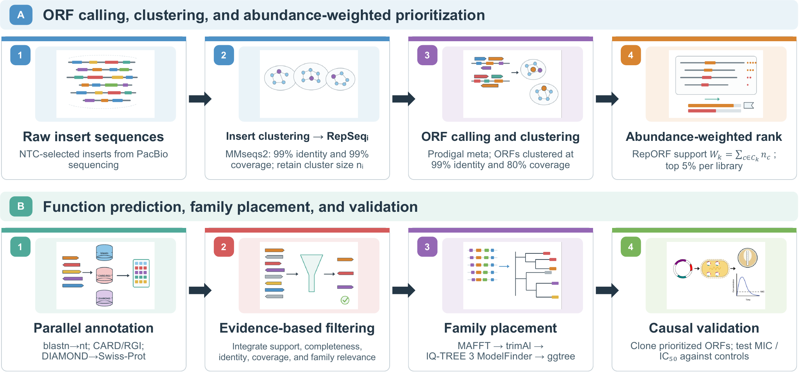

# ARG Annotator

A reproducible, abundance-weighted workflow for candidate discovery from
processed nucleotide insert sequences in functional metagenomic selections.

**Input → insert clustering → ORF prediction → nucleotide ORF clustering →
weighted support → candidate selection → CARD/RGI + Swiss-Prot annotation.**
Both raw insert-cluster and weighted RepORF rank curves are generated automatically.



## Quick start

Use Linux or macOS with Miniforge/Conda; on Windows use WSL2. MMseqs nucleotide
clustering can require substantial RAM even for small inputs. A machine with
at least 24 GB RAM is recommended; requirements increase with data size.

```bash
git clone https://github.com/croftsmicrolab/arg-annotator.git
cd arg-annotator
conda env create -f environment.yml
conda activate arg-annotator

# Download current CARD and reviewed Swiss-Prot and prepare their indexes.
python scripts/setup_databases.py --download

# Use a plain nucleotide FASTA of processed inserts/CCS reads.
cp /path/to/your/processed_sequences.fasta raw/sequences.fasta
python run.py --sample my_library --dry-run
python run.py --sample my_library --cores 8
```

Raw reads and databases are not included. For historical results,
use the exact reference releases rather than downloading `latest`.

Already have reference downloads?

```bash
python scripts/setup_databases.py \
  --card-json /path/to/card.json \
  --swissprot-fasta /path/to/uniprot_sprot.fasta.gz \
  --swissprot-release YOUR_RELEASE
```

## Selection settings

The default is the top **5%** of RepORFs, rounded up. When the nominal cutoff
falls at support 1, the fallback selects all RepORFs with **support ≥2**.
Support-one RepORFs are also exported separately for exploration.

```bash
# Change the percentage (10 means 10%, not 0.10%).
python run.py --input raw/sequences.fasta --top-percent 10 --output results_top10

# Alternative: select every RepORF with support >=2, regardless of percentile.
python run.py --input raw/sequences.fasta --min-support 2 --output results_support2

# Cluster, calculate support, select candidates and draw curves without databases.
python run.py --input raw/sequences.fasta --skip-annotation --output results_core
```

Percentage selection and minimum-support selection are alternative modes.
They are not combined as a union. Equal-support ties within the top-fraction
mode are ordered by ORF member count descending and then RepORF ID ascending;
boundary ties are not automatically expanded, except the support-one fallback.
All settings can also be changed in [config/config.yaml](config/config.yaml).

## Scientific defaults

| Stage | Default |
| --- | --- |
| Input | Plain nucleotide FASTA; A/C/G/T/N; one record = one count |
| Insert clustering | MMseqs2 nucleotide; identity 0.99, coverage 0.99, cov-mode 0, cluster-mode 0 |
| ORF prediction | Prodigal 2.6.3, `-p meta` |
| RepORF clustering | MMseqs2 nucleotide; identity 0.99, coverage 0.80, **cov-mode 1, cluster-mode 2** |
| Weighted support | Sum of original insert-cluster sizes over unique parent insert clusters |
| Candidate selection | Top 5% (ceiling), support-one boundary fallback to support ≥2 |
| CARD | RGI protein mode, DIAMOND, local database, include Loose, low-quality, clean |
| Swiss-Prot | DIAMOND **blastp**, sensitive, E-value ≤1e-3, max 25 targets |
| Curves | Linear rank x-axis, logarithmic y-axis; PNG, SVG, PDF, ranked TSV |
| Execution | Snakemake; 8 cores by default |

If two ORFs from the same parent insert cluster enter one ORF cluster, that
parent's count is included once. For parent cluster sizes 15, 8 and 3, support
is 26, independent of how many ORFs each parent contributes. This value is a
weighted count, not RPM or an estimate of independent biological replicates.
The sum across different RepORFs need not equal the number of input records,
because one insert can contain multiple distinct ORFs.

## Outputs

Default output directory: `results/`.

| Location | Contents |
| --- | --- |
| `00_input/` | Normalized FASTA, original-to-clean ID mapping, sequence QC |
| `01_insert_clusters/` | Memberships, cluster sizes, representative inserts, MMseqs databases |
| `02_orfs/` | Predicted ORF nucleotide/protein FASTA and GFF |
| `03_orf_clusters/` | ORF memberships, representatives, complete ranked `reporf_support.tsv`, parent mapping |
| `04_candidates/` | Selected candidate table/IDs/nucleotide/protein FASTA; support-one exports; selection summary |
| `05_annotations/` | RGI and Swiss-Prot hits, combined `candidate_annotations.tsv`, annotation summary |
| `06_validation/` | Structural checks, including independently recalculated weighted support |
| `07_plots/` | `raw_sequence_cluster_rank.*` and `weighted_reporf_rank.*` |
| `logs/` | Effective settings, software/CARD versions, input/reference/code SHA256 hashes and tool logs |

No-hit candidates, partial ORFs and low-similarity hits remain in the output.
`rgi_search_status` and `swissprot_search_status` distinguish a completed search
from a disabled annotation branch. Evidence classes and confidence labels are
heuristics for triage; Loose CARD or acetyltransferase/GNAT similarity alone
does not establish antibiotic resistance.

For publication, retain the effective configuration, reference release manifest,
input manifest and original hit tables. Reproducing an analysis requires matching
software versions, clustering parameters, RGI input mode, database releases and
Swiss-Prot search settings.

## Documentation

- [Detailed usage](docs/USAGE.md)
- [Database preparation and versions](docs/DATABASES.md)
- [Methods and selection definition](docs/METHODS.md)

Software version: 0.1.0. See [CITATION.cff](CITATION.cff) for citation metadata.
Add the paper's bibliographic information when it is published.
